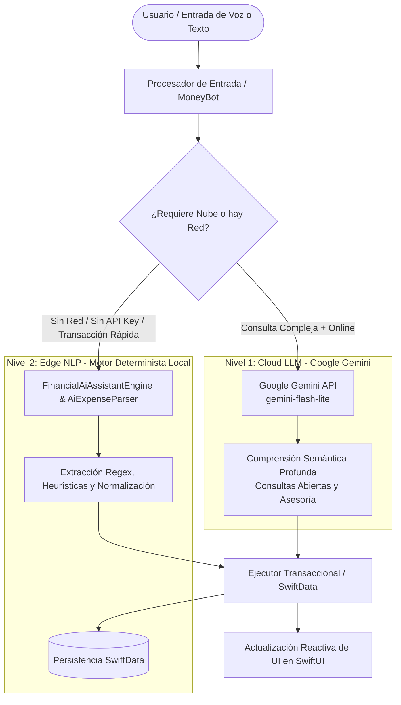

# 💰 MoneyDev — App Inteligente de Gestión Financiera Personal

[](https://developer.apple.com/ios/)
[](https://swift.org)
[](https://developer.apple.com/xcode/)
[](https://developer.apple.com/documentation/swiftdata)
[](https://developer.apple.com/documentation/charts)
[](https://ai.google.dev/)
[]()

> **Capítulo VII: Despliegue y Publicación en GitHub**  
> **Sección 7.1.1 — Documentación del Proyecto de Software**  
> *MoneyDev* es una aplicación nativa para iOS diseñada para la gestión financiera personal avanzada, potenciada por una arquitectura de Inteligencia Artificial híbrida (Cloud LLM + On-Device NLP Engine).

---

## 📌 Tabla de Contenidos
1. [Descripción del Proyecto](#-descripción-del-proyecto)
2. [Arquitectura Técnica Híbrida (Cloud / Edge)](#-arquitectura-técnica-híbrida-cloud--edge)
3. [Tecnologías y Requisitos del Sistema](#-tecnologías-y-requisitos-del-sistema)
4. [Instalación y Configuración](#-instalación-y-configuración)
5. [Configuración de Seguridad (API Keys)](#-configuración-de-seguridad-api-keys)
6. [Estructura del Proyecto](#-estructura-del-proyecto)
7. [Funcionalidades Principales](#-funcionalidades-principales)
8. [Evidencias y Pruebas del Sistema (Sección 7.1.3)](#-evidencias-y-pruebas-del-sistema-sección-713)
9. [Seguridad y Privacidad](#-seguridad-y-privacidad)
10. [Licencia y Créditos](#-licencia-y-créditos)

---

## 📱 Descripción del Proyecto

**MoneyDev** es una solución integral para la gestión proactiva de ingresos, gastos, transferencias y presupuestos personales en el ecosistema iOS. El sistema combina una experiencia de usuario fluida y reactiva en SwiftUI con un asistente financiero inteligente llamado **MoneyBot**.

### Objetivos y Propósito:
- **Automatización del Registro Financiero:** Permitir la captura ágil de movimientos mediante voz continua, lenguaje natural y atajos directos.
- **Asistencia Inteligente Contextual:** Proporcionar análisis en tiempo real, recomendaciones de ahorro y respuestas a consultas sobre el estado financiero.
- **Privacidad y Resiliencia (Offline-First):** Asegurar que las finanzas del usuario se almacenen localmente y que el registro por voz funcione aún sin conexión a internet.
- **Visualización Analítica Clara:** Representar de manera gráfica la distribución de gastos y balances mediante gráficos nativos accesibles.

---

## 🧠 Arquitectura Técnica Híbrida (Cloud / Edge)

MoneyDev implementa un patrón arquitectónico de doble capa para el procesamiento de Inteligencia Artificial, garantizando **alta disponibilidad, confidencialidad de datos y latencia mínima**:



### 1. Nivel Cloud (Google Gemini):
- **Motor:** Modelos Google Gemini (`gemini-flash-lite`, `gemini-3.5-flash-lite`).
- **Función:** Razonamiento complejo de lenguaje natural, detección de patrones de gasto a partir de preguntas abiertas (ej. *"¿Cuánto gasté en comidas este fin de semana y qué me recomiendas recortar?"*), respuestas contextuales inteligentes y modo conversacional.

### 2. Nivel Edge / On-Device (Motor Local de Respaldo):
- **Motor:** `FinancialAiAssistantEngine` y `AiExpenseParser` implementados de forma nativa en Swift.
- **Función:** Procesamiento de lenguaje natural determinista mediante gramáticas formales, expresiones regulares de alta precisión y normalización léxica en español.
- **Ventaja Competitiva:** 
  - **Latencia 0 ms:** Ejecución inmediata sin dependencia de red.
  - **100% Privacidad:** Las transacciones no requieren abandonar el dispositivo.
  - **Fallback Automático:** Si la API de Gemini experimenta límites de cuota (HTTP 429), tiempo de espera o el dispositivo entra en modo avión, el motor local toma el control instantáneamente sin interrumpir la experiencia de usuario.

---

## 🛠 Tecnologías y Requisitos del Sistema

| Componente | Especificación Mínima | Recomendado |
| :--- | :--- | :--- |
| **Sistema Operativo** | iOS 17.0+ | iOS 17.5+ / iOS 18.0+ |
| **Lenguaje de Programación** | Swift 5.9 | Swift 5.10 / Swift 6 Mode |
| **IDE de Desarrollo** | Xcode 15.0+ | Xcode 15.4 / 16.0+ |
| **Capa de Persistencia** | SwiftData (`@Model`, `@Query`) | SwiftData con migración de esquema |
| **Visualización Gráfica** | Swift Charts (`Chart`, `SectorMark`, `BarMark`) | Swift Charts nativo reactivo |
| **Procesamiento de Audio** | AVFoundation & Speech (`SFSpeechRecognizer`) | Reconocimiento en tiempo real |
| **Integraciones de Sistema** | WidgetKit & ActivityKit | Dynamic Island y Pantalla de Bloqueo |
| **Autenticación Biométrica**| LocalAuthentication (Face ID / Touch ID) | Criptografía del dispositivo |

---

## 🚀 Instalación y Configuración

Sigue estos pasos para compilar y ejecutar el proyecto en tu entorno local:

### 1. Clonar el Repositorio
```bash
git clone https://github.com/TU_USUARIO/MoneyDev.git
cd MoneyDev
```

### 2. Configurar las Credenciales Seguras
MoneyDev utiliza una arquitectura de configuración protegida para no exponer credenciales privadas en el repositorio. Copia la plantilla de secretos:

```bash
cp Secrets.plist.example Secrets.plist
```

Abre `Secrets.plist` y reemplaza el marcador con tu API Key obtenida en [Google AI Studio](https://aistudio.google.com/app/apikey):

```xml
<?xml version="1.0" encoding="UTF-8"?>
<!DOCTYPE plist PUBLIC "-//Apple//DTD PLIST 1.0//EN" "http://www.apple.com/DTDs/PropertyList-1.0.dtd">
<plist version="1.0">
<dict>
    <key>GEMINI_API_KEY</key>
    <string>AIzaSyTuClaveRealDeGoogleGeminiAqui...</string>
</dict>
</plist>
```

> 💡 **Nota:** Si prefieres no usar `Secrets.plist`, puedes ingresar tu API Key directamente desde la app en la pantalla de **Ajustes > Configurar API Key de Gemini**, o configurarla como variable de entorno `GEMINI_API_KEY` en el esquema de Xcode. Si no se provee clave, la aplicación operará automáticamente con el motor local offline.

### 3. Abrir el Proyecto en Xcode
```bash
open MoneyDev.xcodeproj
```

### 4. Compilar y Ejecutar
1. Selecciona el esquema **MoneyDev**.
2. Escoge un simulador con **iOS 17.0 o superior** (ej. *iPhone 15 Pro* o *iPhone 16 Pro*).
3. Presiona `Cmd + R` para compilar y ejecutar la app.

---

## 🔐 Configuración de Seguridad (API Keys)

De acuerdo con las buenas prácticas de desarrollo en iOS y los estándares de seguridad de software:

1. **Aislamiento de Secretos:** Los archivos `Secrets.plist`, `Config.xcconfig` y `.env` se encuentran explícitamente ignorados en `.gitignore`.
2. **Plantillas Versionadas:** Se proveen los archivos seguros `Secrets.plist.example`, `Config.xcconfig.example` y `.env.example` para facilitar la configuración por parte de evaluadores y colaboradores.
3. **Mapeo Seguro en `EnvConfig`:** El gestor `EnvConfig.swift` implementa una jerarquía segura de carga de variables en tiempo de ejecución:
   1. Clave almacenada en `UserDefaults` (Ajustes de la App).
   2. Archivo `Secrets.plist` cargado dinámicamente en tiempo de ejecución.
   3. Inyección vía `Info.plist` / `xcconfig`.
   4. Variables de entorno de proceso (`ProcessInfo.processInfo.environment`).
   5. Fallback seguro sin credenciales expuestas en el código fuente.

---

## 📂 Estructura del Proyecto

El proyecto sigue una arquitectura limpia basada en **MVVM (Model-View-ViewModel) + Repository Pattern**:

```text
MoneyDev/
├── Config/                          # Plists de configuración del sistema (Info.plist)
├── MoneyDev/
│   ├── Assets.xcassets/             # Catálogo de recursos gráficos, colores e iconos
│   ├── Icons/                       # Iconos alternativos (Basic y Pro)
│   ├── Models/                      # Modelos de datos SwiftData (@Model)
│   │   ├── Transaction.swift        # Entidad de transacción (ingreso, gasto, transferencia)
│   │   ├── Wallet.swift             # Billeteras y cuentas financieras
│   │   ├── FixedExpense.swift       # Gastos fijos recurrentes y vencimientos
│   │   ├── FinancialSummary.swift   # Métricas y agregaciones de saldos
│   │   └── UserProfile.swift        # Perfil y estado de usuario
│   ├── Repository/                  # Capa de abstracción de datos
│   │   └── ExpenseRepository.swift  # Operaciones CRUD sobre SwiftData
│   ├── Resources/                   # Efectos sonoros y recursos de audio nativos
│   ├── Services/                    # Lógica de negocio y servicios del sistema
│   │   ├── EnvConfig.swift          # Gestión segura de entorno y secretos
│   │   ├── MoneyBotAIService.swift  # Integración REST con Google Gemini API
│   │   ├── FinancialAiAssistantEngine.swift # Motor híbrido y orquestador NLP
│   │   ├── AiExpenseParser.swift    # Parser determinista local y fallback
│   │   ├── SpeechRecognitionService.swift   # Reconocimiento de voz continuo
│   │   ├── TextToSpeechService.swift        # Síntesis de voz auditiva
│   │   ├── MoneyBotLiveVoiceController.swift# Controlador de voz en vivo
│   │   ├── AppSecurityManager.swift # Protección biométrica Face ID / PIN
│   │   └── ReminderScheduler.swift  # Notificaciones locales de gastos fijos
│   ├── Theme/                       # Sistema de diseño, tokens de color y tipografías
│   │   └── AppColors.swift
│   ├── Utils/                       # Formateadores, helpers y utilidades
│   │   ├── CategoryHelper.swift     # Clasificación y categorización inteligente
│   │   ├── FormatHelper.swift       # Formateo de monedas, fechas y porcentajes
│   │   └── ReportExportHelper.swift # Generación de reportes y exportación
│   ├── ViewModels/                  # Capa de presentación y estado reactivo
│   │   └── ExpenseViewModel.swift   # Orquestador del estado global de la app
│   └── Views/                       # Vistas SwiftUI modulares
│       ├── ExpenseHomeScreen.swift  # Pantalla principal (Dashboard)
│       └── Components/              # Diálogos, tarjetas, orbe de voz y componentes
├── MoneyDevWidgets/                 # Extensión de Widgets y Live Activities (WidgetKit)
│   ├── MediumWalletWidget.swift     # Widget de saldo mediano
│   ├── SmallWalletWidget.swift      # Widget compacto
│   └── MoneyBotLiveActivityWidget.swift # Dynamic Island y Live Activity
├── docs/                            # Documentación técnica académica (Capítulo VII)
│   ├── README.md                    # Índice de documentación
│   └── evidencias/                  # Sección 7.1.3: Capturas, diagramas y pruebas
├── Secrets.plist.example            # Plantilla para Secretos
├── Config.xcconfig.example          # Plantilla para compilación Xcode
├── .env.example                     # Plantilla de variables de entorno
└── .gitignore                       # Configuración de exclusión para Git
```

---

## ✨ Funcionalidades Principales

1. **MoneyBot Live Voice con Orbe Reactivo:**
   - Asistente de voz en tiempo real con orbe animado de ondas acústicas.
   - Detección continua de voz y confirmación auditiva instantánea.

2. **Gestión Multibilletera y Multidivisa:**
   - Soporte para efectivo, cuentas bancarias (BCP, Interbank, BBVA) y billeteras móviles.
   - Transferencias entre billeteras con actualización atómica de saldos.

3. **Control Automatizado de Gastos Fijos:**
   - Programación de servicios recurrentes (alquiler, luz, suscripciones).
   - Notificaciones y alertas de vencimiento para evitar penalidades.

4. **Visualizaciones con Swift Charts:**
   - Gráficos interactivos de barras comparativas y distribución de categorías.
   - Filtros dinámicos por períodos (Hoy, Esta Semana, Este Mes, Rango Personalizado).

5. **Seguridad y Control de Acceso:**
   - Bloqueo de la aplicación mediante Face ID, Touch ID o código PIN de 4 dígitos.
   - Ocultamiento de saldos sensibles ante miradas indiscretas.

6. **Integración con el Sistema iOS:**
   - Widgets interactivos para la pantalla de inicio con saldo actualizado.
   - Dynamic Island y Live Activities para monitoreo activo de operaciones.

---

## 📊 Evidencias y Pruebas del Sistema (Sección 7.1.3)

Para dar cumplimiento riguroso a la **Sección 7.1.3** de la rúbrica académica, consulta el catálogo detallado en:

👉 [**docs/evidencias/README.md**](docs/evidencias/README.md)

El repositorio incluye las carpetas estructuradas:
- `docs/evidencias/capturas/`: Pantallas de la app en ejecución (Dashboard, MoneyBot, Swift Charts, Seguridad).
- `docs/evidencias/diagramas/`: Diagramas de arquitectura, flujo de datos de audio/NLP y modelo relacional.
- `docs/evidencias/pruebas/`: Casos de prueba unitaria, pruebas de fallback offline y análisis de latencia.

---

## 🔒 Seguridad y Privacidad

- **Cero Fugas de Credenciales:** El repositorio no almacena credenciales ni tokens en su historial de commits.
- **Privacidad Local por Defecto:** Los datos financieros personales se guardan localmente en el dispositivo utilizando el framework SwiftData respaldado por SQLite con sandboxing estricto de iOS.
- **Acceso Biométrico Local:** La autenticación se valida en el Secure Enclave del dispositivo sin transmitir datos biométricos.

---

## 👤 Autor y Créditos Académicos

- **Proyecto:** MoneyDev — App Inteligente de Gestión Financiera Personal
- **Autor:** Max Valerio
- **Entorno:** iOS 17+, Swift 5.9+, Xcode 15+, SwiftData, Swift Charts, Google Gemini
- **Documentación Académica:** Capítulo VII — Despliegue y Publicación en GitHub
