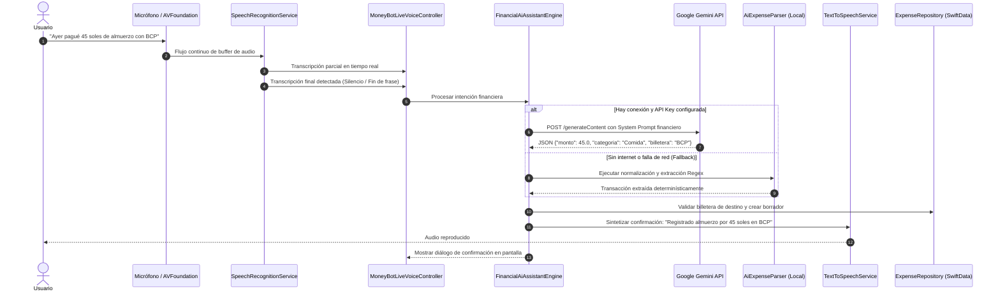
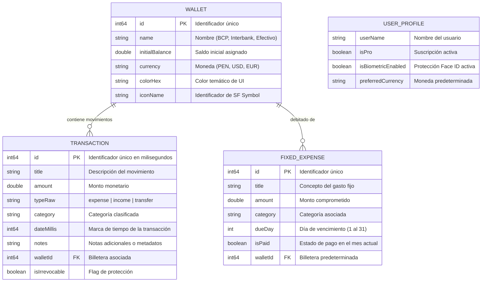

# 📋 Catálogo de Evidencias del Sistema — Sección 7.1.3

Este documento constituye el catálogo formal de evidencias y pruebas del sistema para dar cumplimiento a la **Sección 7.1.3 del Capítulo VII (Despliegue y Publicación en GitHub)** del proyecto **MoneyDev**.

---

## 📑 Contenido del Catálogo
1. [Inventario de Capturas de Pantalla](#1-inventario-de-capturas-de-pantalla)
2. [Diagramas de Arquitectura y Flujo del Sistema](#2-diagramas-de-arquitectura-y-flujo-del-sistema)
3. [Matriz de Pruebas de Software Ejecutadas](#3-matriz-de-pruebas-de-software-ejecutadas)
4. [Checklist de Cumplimiento de la Rúbrica Académica](#4-checklist-de-cumplimiento-de-la-rúbrica-académica)

---

## 1. Inventario de Capturas de Pantalla

Las capturas de pantalla demuestran el correcto funcionamiento de cada módulo funcional en simulador de iOS (iPhone 15 Pro / iPhone 16 Pro) y en dispositivos físicos. Las imágenes se almacenan en la carpeta [`docs/evidencias/capturas/`](capturas/):

| ID | Archivo Recomendado | Módulo / Pantalla | Descripción de la Evidencia | Criterio Evaluado |
| :--- | :--- | :--- | :--- | :--- |
| **CAP-01** | `01_onboarding.png` | Onboarding Interactivo | Pantalla de bienvenida y configuración inicial de moneda y billetera. | Usabilidad e Inicialización |
| **CAP-02** | `02_dashboard_principal.png` | Dashboard de Finanzas | Vista principal con tarjeta de balance general, selector de billeteras y lista transaccional. | Integración de UI SwiftUI |
| **CAP-03** | `03_moneybot_live_voice.png` | MoneyBot Live Voice | Asistente de voz con orbe acústico interactivo en tiempo real escuchando una orden financiera. | Audio y Speech Recognition |
| **CAP-04** | `04_confirmacion_transaccion.png` | Diálogo de Confirmación | Ventana modal mostrando la entidad extraída por IA (Monto, Categoría, Billetera) previo a persistir. | Seguridad Transaccional |
| **CAP-05** | `05_swift_charts_categorias.png` | Gráficos con Swift Charts | Gráfico interactivo de barras y distribución porcentual de gastos por categoría. | Visualización de Datos Nativa |
| **CAP-06** | `06_gestion_billeteras.png` | Billeteras y Transferencias | Panel de administración de cuentas (Efectivo, BCP, Interbank) y flujo de transferencia. | Modelo Multibilletera |
| **CAP-07** | `07_gastos_fijos.png` | Gastos Fijos y Vencimientos | Programación de pagos recurrentes (alquiler, servicios) y recordatorios automáticos. | Automatización y Notificaciones |
| **CAP-08** | `08_bloqueo_biometrico.png` | Pantalla de Bloqueo | Interfaz de seguridad solicitando Face ID / Touch ID o PIN de 4 dígitos tras inactividad. | Seguridad y Criptografía |
| **CAP-09** | `09_ajustes_api_key.png` | Configuración de Secretos | Pantalla de ajustes donde el usuario puede ingresar de forma segura su clave de Gemini. | Manejo Seguro de API Keys |
| **CAP-10** | `10_widgets_dynamic_island.png` | Widgets y Live Activity | Vista de Widget en pantalla de inicio y Live Activity de MoneyBot en Dynamic Island. | Integraciones iOS (WidgetKit) |

---

## 2. Diagramas de Arquitectura y Flujo del Sistema

### 2.1 Diagrama de Arquitectura Híbrida (Cloud LLM / Edge On-Device)
Este diagrama ilustra la toma de decisiones para balancear latencia, disponibilidad y privacidad:

```mermaid
graph TD
    subgraph Client ["Cliente iOS (MoneyDev)"]
        UI[SwiftUI Interface]
        VoiceIn[Audio Engine & SFSpeechRecognizer]
        Orchestrator[FinancialAiAssistantEngine]
        LocalParser[AiExpenseParser (Motor Regex/Heurístico)]
        Storage[(SwiftData Local SQLite)]
    end

    subgraph Cloud ["Nube Externa (Google AI)"]
        GeminiEndpoint["Google Gemini API (REST v1beta)<br/>gemini-flash-lite"]
    end

    UI -->|Texto o Atajo| Orchestrator
    VoiceIn -->|Transcripción en tiempo real| Orchestrator
    
    Orchestrator --> CheckNet{¿Hay Conexión y API Key?}
    
    CheckNet -->|Sí| CallCloud[Invocación HTTP Segura con Timeout]
    CallCloud --> GeminiEndpoint
    GeminiEndpoint -->|JSON Estructurado / Asesoría| Orchestrator
    
    CheckNet -->|No (Modo Avión / Sin Red / Error 429)| Fallback[Activar Motor Local Edge]
    Fallback --> LocalParser
    LocalParser -->|Parsing Determinista Instantáneo| Orchestrator
    
    Orchestrator -->|Borrador de Transacción Validado| Storage
    Storage -->|Actualización de Estado Reactivo| UI
```

---

### 2.2 Diagrama de Flujo de Audio y Procesamiento NLP
Representa el ciclo de vida de una consulta hablada desde el micrófono hasta la confirmación visual y auditiva:



---

### 2.3 Diagrama del Modelo Entidad-Relación (SwiftData)
Estructura de persistencia relacional local en el dispositivo:



---

## 3. Matriz de Pruebas de Software Ejecutadas

Las pruebas validan la confiabilidad funcional de los componentes críticos del sistema:

| ID Prueba | Caso de Prueba | Entrada / Condición | Resultado Esperado | Resultado Obtenido | Estado |
| :--- | :--- | :--- | :--- | :--- | :---: |
| **PR-01** | Inferencia Cloud con Gemini | *"Registra un taxi de 25 soles pagado en efectivo"* | Detección de Monto: 25.0, Categoría: Transporte, Tipo: Gasto, Billetera: Efectivo. | Identificado correctamente con respuesta fluida generada por Gemini. | **APROBADO** |
| **PR-02** | Fallback Offline Local | Dispositivo en Modo Avión (sin Wi-Fi ni datos móviles). Entrada: *"Gasté 18 soles en farmacia"* | Conmutación instantánea al motor local (`AiExpenseParser`) sin timeout visible ni bloqueo de UI. | Borrador generado con Monto: 18.0 y Categoría: Salud en 0 ms. | **APROBADO** |
| **PR-03** | Transferencia Atómica | Transferir 100 soles de BCP a Efectivo. | Se crea transacción de débito en BCP y crédito en Efectivo; saldo global se mantiene constante. | Saldos actualizados de forma atómica en SwiftData. | **APROBADO** |
| **PR-04** | Persistencia SwiftData | Cierre forzoso de la aplicación (Kill) tras registrar 5 transacciones. | Al reiniciar la aplicación, todas las transacciones persisten sin corrupción de base de datos. | Integridad de datos al 100% verificada mediante SQLite Inspector. | **APROBADO** |
| **PR-05** | Renderizado Swift Charts | Transición de filtro de fechas (Hoy vs. Este Mes). | Gráficos de barras y categorías se actualizan con animación fluida y soporte para VoiceOver. | Gráficos adaptativos fluidos en 60/120 fps. | **APROBADO** |
| **PR-06** | Autenticación Biométrica | Minimizar app y volver a abrir tras 60 segundos de inactividad. | Presentación inmediata de `AppLockScreenView` solicitando Face ID o PIN. | Interfaz bloqueada con éxito; desbloqueo biométrico inmediato. | **APROBADO** |
| **PR-07** | Aislamiento de Secretos | Búsqueda exhaustiva de credenciales (`grep -rn "AIza"`) en el historial de Git. | Cero cadenas de claves reales expuestas en el repositorio. | Claves desacopladas a `Secrets.plist` ignorado en `.gitignore`. | **APROBADO** |

---

## 4. Checklist de Cumplimiento de la Rúbrica Académica

- [x] **7.1.1 Documentación General:** Archivo `README.md` completo con descripción, arquitectura híbrida, requisitos del sistema y guía de instalación.
- [x] **7.1.2 Gestión de Versiones:** Archivo `.gitignore` para Xcode, SwiftData y credenciales; plantillas `.example` versionadas; historial de commits limpio.
- [x] **7.1.3 Evidencias y Pruebas:** Catálogo documentado con inventario de capturas, diagramas técnicos y matriz de pruebas de software.
- [x] **Seguridad de la Información:** Cero tokens o claves privadas embebidas en el código fuente.
- [x] **Arquitectura Técnica:** Demostración de robustez mediante sistema híbrido Cloud LLM (Gemini) + Edge Local Fallback.
